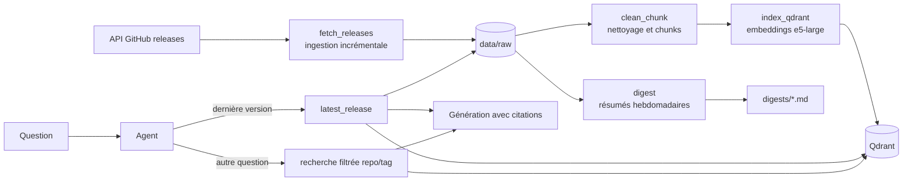

# Veille data engineering et IA : RAG avec agent

Assistant qui répond à des questions sur les notes de version (releases GitHub) de six outils de data engineering et d'IA : Airflow, Dagster, Iceberg, Delta Lake, Qdrant et LlamaIndex. Il cite ses sources et dit « je ne sais pas » quand le corpus ne contient pas la réponse. Un digest hebdomadaire résume automatiquement les nouveautés. Tout tourne en local et gratuitement, sans clé d'API.

Le projet insiste sur la **mesure** : chaque amélioration est comparée à une baseline chiffrée, et les échecs sont analysés plutôt que cachés.

## Ce que fait le projet

1. **Questions-réponses (RAG avec agent).** Exemples : « Quelle faille de sécurité a été corrigée dans Qdrant v1.19.0 ? », « Quelle est la dernière version d'Airflow ? ».
2. **Digest de veille.** Un résumé en français des releases récentes, écrit dans `digests/` et planifié chaque lundi avec Dagster.

Corpus actuel : 60 releases (10 par dépôt), découpées en 1529 chunks.

## Architecture



Dagster orchestre deux jobs :

- `veille_quotidienne` (7 h UTC) : récupération, découpage, indexation. Seules les nouvelles releases et les nouveaux chunks sont traités.
- `digest_hebdomadaire` (lundi 8 h UTC) : génération du digest.

## Choix techniques

| Rôle | Outil | Pourquoi |
|---|---|---|
| Embeddings | `intfloat/multilingual-e5-large` (via fastembed) | Questions en français sur des documents en anglais |
| Base vectorielle | Qdrant en mode local | Aucune installation de serveur |
| LLM | `qwen2.5:7b` via Ollama, température 0 | Gratuit et local |
| Orchestration | Dagster | Dépendances entre étapes, historique, planification |
| Tests | pytest | Nettoyage, découpage, fusion incrémentale, identifiants de chunks, filtres |

## Résultats

Jeu d'évaluation : 17 questions avec réponse dans le corpus et 2 questions sans réponse (le système doit refuser). Questions et mots-clés attendus dans `eval/`.

### Retrieval (14 questions initiales)

| Configuration | Bonne release en 1re position | Mots-clés de la réponse dans les chunks envoyés |
|---|---|---|
| Sans filtre, K = 5 | 12/14 | 12/14 |
| Filtre repo/tag, K adaptatif (5 sans filtre, 8 avec filtre) | 13/14 | 13/14 |

### Génération

| Configuration | Questions | Contenu correct | Citation correcte |
|---|---|---|---|
| RAG sans filtre, K = 5 | 14 | 10/14 (8/14 avant correction de deux mots-clés trop stricts) | 10/14 |
| Filtre repo/tag, K = 5 | 14 | 11/14 | 12/14 |
| Filtre repo/tag, K adaptatif (8 avec filtre) | 14 | 12/14 | 12/14 |
| Agent, première version | 14 | 12/14 | 12/14 |
| Agent + règle « version nommée » + contenu de la release | 14 | 13/14 | 13/14 |
| Même configuration, avec 3 questions « dernière version » (q017 à q019) | 17 | 15/17 (16/17 avec q017 assouplie) | 15/17 |

Refus corrects sur les questions sans réponse : 2/2 dans toutes les configurations.

### Ce que chaque changement a corrigé ou cassé

| Changement | Effet |
|---|---|
| Filtre sur le dépôt et la version cités dans la question | Question sur la faille de sécurité corrigée |
| K = 8 quand le filtre est actif | Question sur la dépréciation corrigée (chunk au 6e rang sur 7) ; une citation dégradée |
| Agent avec outil `latest_release` | Question « version la plus récente » corrigée (impossible par recherche de texte) ; une autre question cassée par un appel d'outil à tort |
| Règle : une question qui nomme une version n'appelle pas `latest_release` | Régression corrigée |
| `latest_release` renvoie aussi le contenu de la release | « Quoi de neuf dans la dernière version ? » passe d'un refus à une réponse fidèle |

## Limites connues

- **Petit jeu de test, une seule exécution par configuration.** Un point d'écart correspond à une seule question.
- **Couverture limitée.** Le jeu porte presque entièrement sur Qdrant et Dagster. Une seule question concerne Airflow, et aucune ne concerne Iceberg, LlamaIndex ou Delta Lake.
- **Réglages décidés après avoir vu les échecs** (K = 8, règle sur les versions, outil enrichi) : les gains ne constituent pas un test indépendant.
- **Les questions q017 à q019 ont été écrites après avoir observé l'échec de l'outil `latest_release`** : elles vérifient la correction, elles ne constituent pas un test indépendant. Les 14 premières ont servi à régler le système.
- **Mots-clés d'évaluation assouplis après coup** pour trois questions (q002, q013, q017), parce que des réponses justes étaient notées fausses. Les scores du tableau utilisent les mots-clés assouplis ; avant correction, la première configuration donnait 8/14 en contenu.
- **Évaluation par mots-clés, donc approximative.** Une réponse juste mais reformulée peut être notée fausse (c'est le cas de la question « quoi de neuf », jugée fidèle à la main).
- **Échecs restants** : une réponse incomplète (un seul des deux changements attendus), une question multi-releases où seul un des deux faits est cité, et des citations parfois oubliées par le modèle.
- **Le corpus évolue.** Les questions sur la « dernière version » et leurs réponses datent du 8 novembre 2026 ; elles sont à mettre à jour après une nouvelle ingestion.
- **Digest relu à la main sur quelques releases, sans score.** Le modèle 7B choisit parfois des détails plutôt que l'essentiel, peut omettre une réserve (« expérimental ») et fait des fautes de français. Chaque résumé renvoie vers la release d'origine.
- **Questions et réponses attendues rédigées avec l'aide d'un assistant IA**, à partir du texte de quelques releases (Qdrant, Dagster). Quelques points ont été revérifiés dans le corpus (par exemple l'absence de `turbo2`), mais pas toutes les questions.
- Qdrant en mode local verrouille son dossier : un seul programme à la fois.

## Lancer le projet (Windows, PowerShell)

Prérequis : Python 3.13 (version utilisée pendant le développement), [Ollama](https://ollama.com) et Git. Ollama doit tourner en arrière-plan pour l'agent et le digest.

```powershell
git clone https://github.com/iness-karim/rag-agentic
cd rag-agentic
python -m venv .venv
.venv\Scripts\Activate.ps1
pip install -r requirements.txt

ollama pull qwen2.5:7b

# Un token GitHub est optionnel : il relève la limite de l'API
copy .env.example .env

# Première exécution : récupération, découpage, indexation (télécharge le modèle d'embedding, environ 2 Go)
python -m src.pipeline --rebuild
```

Poser une question :

```powershell
python -m src.agent.agent "Quelle est la dernière version de Qdrant ?"
```

Mesurer :

```powershell
python -m src.evaluation.eval_retrieval
python -m src.evaluation.eval_generation --agent
```

Générer un digest et lancer l'orchestrateur :

```powershell
python -m src.digest.digest --days=14

mkdir .dagster
$env:DAGSTER_HOME = "$PWD\.dagster"
dagster dev -m src.orchestration.definitions
```

L'interface est ensuite sur http://localhost:3000. Les planifications sont désactivées par défaut dans Dagster et ne s'exécutent que tant que `dagster dev` tourne.

Tests : `python -m pytest -q`

Un nouveau clone ne retrouvera pas exactement le même corpus : l'API ne renvoie que les 10 dernières releases de chaque dépôt, au moment du lancement.

## Structure du dépôt

```
data/raw/            releases brutes (JSON)
data/processed/      chunks nettoyés
digests/             digests générés
eval/                questions, mots-clés attendus, résultats
src/ingestion/       récupération et découpage
src/rag/             indexation, recherche, génération
src/agent/           agent et outils
src/evaluation/      scripts d'évaluation
src/digest/          digest hebdomadaire
src/orchestration/   définitions Dagster
tests/               tests unitaires
```

## Suite prévue

- Déploiement avec Docker (Qdrant en serveur).
- Questions sur Airflow, Iceberg, LlamaIndex et Delta Lake, écrites après avoir figé la configuration, pour un test indépendant.
- Mesure du retrieval au niveau du chunk, recherche hybride, reranking.